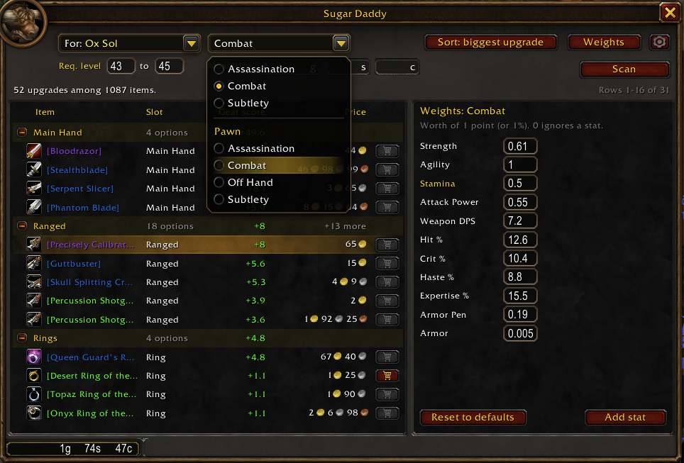
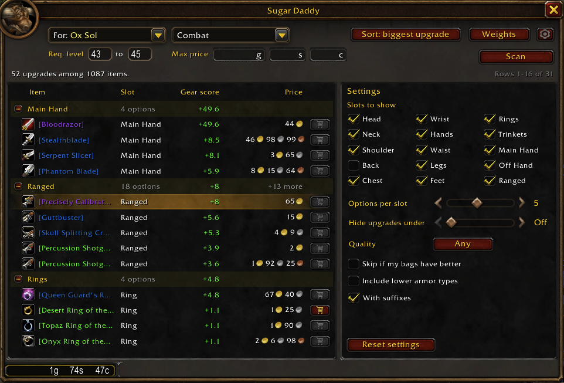

# Sugar Daddy

Finds gear upgrades on the auction house that you can actually afford.

It scans the AH for items in your level range, scores them against your spec's
stat weights, and lists what beats your current gear, grouped by slot. Sort by
biggest upgrade or by upgrade per gold, and buy straight from the list.

## Usage

Open the auction house, click the **Sugar Daddy** tab and hit **Scan**.
Set a required level range and a max price to narrow things down.

### Weights

The spec menu starts on the spec your talents point to; pick another to shop for it. **Weights** shows what
each stat is worth to that spec; change any number or add stats you care about.

Use [Pawn](https://www.curseforge.com/wow/addons/pawn)? The spec menu also lists the scales Pawn shows for your
character, its defaults or your own. Pick one, edit its numbers in Pawn, and Sugar Daddy follows. Pawn is optional.

### Settings

The gear button: which slots to show, how many options per slot, minimum
upgrade and quality, skipping items your bags already beat, lower armor
types, and whether to check suffix items ("of the Monkey") listing by listing.

## Install

1. On GitHub, click **Code → Download ZIP** and unpack it.
2. Rename the folder from `SugarDaddy-master` to `SugarDaddy`. WoW won't load
   the addon otherwise.
3. Move it into `World of Warcraft/_classic_era_/Interface/AddOns` (or the
   folder for whichever Classic version you play).

## License

MIT. See [LICENSE](LICENSE).
