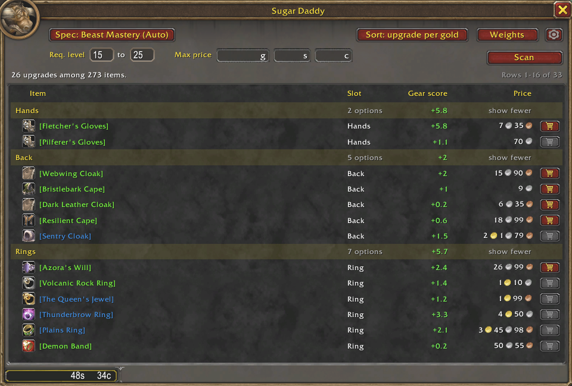

# Sugar Daddy

Finds gear upgrades on the auction house that you can actually afford.

It scans the AH for items in your level range, scores them against your spec's
stat weights, and lists what beats your current gear, grouped by slot. Sort by
biggest upgrade or by upgrade per gold, and buy straight from the list.



## Usage

Open the auction house, click the **Sugar Daddy** tab and hit **Scan**.

- Spec is picked from your talents, or set it by hand.
- **Weights** lets you tweak how much each stat is worth.
- Set a required level range and a max price to narrow things down.
- The gear button has extra filters: skip slots, minimum quality, ignore
  items worse than what's in your bags, and so on.

## Commands

```
/sugar                  open the tab
/sugar scan             scan (AH must be open)
/sugar price 2g50s      max price, 0 for no limit
/sugar weight agi 1.2   set a stat weight
/sugar stats            list stat keys
/sugar reset            reset weights for the current spec
```

## Install

Drop the `SugarDaddy` folder into `Interface/AddOns`.

## License

MIT. See [LICENSE](LICENSE).
